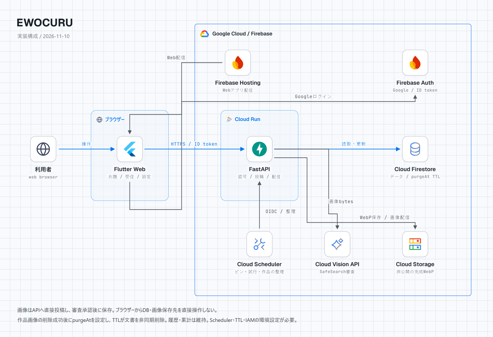

# EWOCURU

### エガク、オクル、ソノサキノミライヘ。

「描いてほしい」と「描いてみたい」をつなぐ、お絵描きマッチングサービス

## プロジェクトの概要

EWOCURU（エオクル）は、「描いてほしい人」と「描いてみたい人」が、アイデアとイラストを通じて出会う創作交流サービスです。

お題を投稿したら、描き手がタイムラインから心ひかれるアイデアを選んで作品を投稿。作品はお題の投稿者の受信箱に届きます。依頼や報酬がなくても、誰かのアイデアをきっかけに描き、作品を届けられます。

## [Webアプリ版はこちら](https://ewocuru.web.app/)

### こんな人に

| お題を投稿する人 | 絵を描く人 |
| --- | --- |
| 描いてほしいイメージがあるけれど、自分では絵にできない | 描くことは好きだけれど、題材やアイデアを探している |
| 自分のアイデアを、誰かの作品として見てみたい | 作品を通して、自分の絵を誰かに届けたい |

### 使い方

| 1. アイデアを投稿 | 2. 描きたいアイデアを選ぶ | 3. 作品を受け取る |
| --- | --- | --- |
| 描いてほしい内容をタイムラインに投稿します | 描き手は一覧から気になるお題を選び、イラストを制作・投稿します | 作品は投稿者の受信箱へ届き、閲覧・保存や「いいね」ができます |

### EWOCURUでできること

- **描きたい題材に出会う**: 公開中のアイデアをタイムラインで探し、気になったお題をピンに保存できます。
- **作品を相手に届ける**: 描いたイラストをお題の投稿者へ送信できます。作品は受信者だけが閲覧でき、投稿者は保存や「いいね」で感謝を伝えられます。
- **創作の歩みを残す**: アイデアの履歴や描いた履歴を確認できます。作品の閲覧期間が終わった後も、描いた記録や受け取った「いいね」は残ります。
- **プロフィールを相手に伝える**: 作品を送るときに選ぶと、受け取った人にプロフィールを公開できます。不特定多数への公開ではなく、作品を届けた相手に自分を知ってもらうきっかけになります。

## 既存サービスとの差別化

| 比較項目 | お題箱 | Skeb | ArtFight | EWOCURU |
| --- | --- | --- | --- | --- |
| 主な使い方 | 匿名のお題やメッセージを受け付ける | 報酬を伴うイラスト等のコミッションを依頼する | 年ごとのチーム対抗イベントで、相手チームのキャラクターを描く | タイムラインからアイデアを選び、描いた作品を投稿者へ届ける |
| 交流の形 | お題・メッセージの送受信 | 有償リクエストと納品 | 作品投稿とチーム得点を通じたイベント交流 | アイデア投稿と作品の受け取りを通じた創作交流 |
| 期間・参加条件 | お題箱ごとの受付設定 | クリエイターへの有償依頼 | 年ごとのイベント期間・チーム参加 | 公開中のアイデアをいつでも選択。掲載・受付期間やピン機能あり |
| 作品・履歴 | お題やメッセージを確認 | 依頼作品を納品 | イベント内で作品を投稿 | 受信者向け受信箱、アイデア履歴、描いた履歴をアプリ内で確認 |

| サービス | 公式情報 |
| --- | --- |
| お題箱 | [よくある質問](https://odaibako.net/faq) |
| Skeb | [サービス紹介](https://skeb.co.jp/) |
| ArtFight | [About](https://artfight.net/index.php/info/about) |

## 実装した機能

- **画像審査付きの作品投稿**: 描き手はお題ごとに1作品を投稿できます。画像を検証・WebP変換し、Cloud Vision SafeSearchの審査を通過した場合だけ保存します。二重送信や通信失敗時にも投稿状態と実績が重複しないよう、予約・確定を管理します。
- **受信者だけが見られる作品受信箱**: 作品画像は投稿したお題の相手だけが閲覧・保存でき、APIで本人確認・受信者確認・閲覧期限を検証します。画像は送信確定から7日で閲覧できなくなり、期限後の削除処理にも対応しています。
- **Googleログインとサーバー側の認可**: Firebase Authenticationでログインし、FastAPIがトークン、利用状態、お題や作品の所有者を確認します。Firestoreの直接アクセスを制限し、データ操作をAPI経由にしています。
- **お題タイムラインと掲載・受付期限**: お題の投稿、タグ表示、一覧・詳細、投稿者のお題履歴に対応。掲載期間と受付期間を分け、期限や削除状態に応じて閲覧・投稿可否を判定します。
- **ピンと投稿枠の管理**: 気になるお題の保存と、投稿者ごとの掲載枠を提供します。登録・解除・上限判定はトランザクションで処理し、期限切れピンや未完了アップロード、期限切れ作品を専用の内部処理で整理できます。
- **受信作品の既読・いいねと創作履歴**: 受信箱で未読・既読を管理し、受信者は作品にいいねできます。描いた履歴や投稿数・描いた数・受け取ったいいね数は、画像の閲覧期限後も確認できます。
- **作品単位のプロフィール公開**: 描き手が投稿時に選んだ場合のみ、その作品の受信者へニックネーム・自己紹介・SNSリンクを公開します。一般公開プロフィールにはせず、作品ごとに公開範囲を制御します。
- **投稿・操作の制限と安全な運用**: お題作成や作品投稿などに利用者単位の頻度制限を設けています。定期整理APIは専用サービスアカウントのOIDC認証を要求し、再試行や途中失敗からの回復に対応します。
- **Webアプリとデプロイ環境**: Flutter Web、Firebase Hosting、FastAPI / Cloud Runで構成し、CIによる検証・デプロイ手順を用意しています。

## 技術部分で工夫した点
- 画像をWebPに変換して保存：投稿画像は形式やサイズを検証したうえでWebPに変換します。大きな画像をそのまま保存・配信する場合に比べ、ストレージ容量や通信量を抑えます。
- アップロードサイズを制限：画像は最大20 MiB、リクエスト本文は最大20 MiB＋64 KiBまでに制限し、過大なリクエストによる負荷を抑えます。
- 画像審査を通過したものだけ保存：Cloud Vision SafeSearchで画像を判定し、審査を通過した場合にだけ作品として確定します。判定不能やサービス障害時は確定しない設計です。
- 作品画像に閲覧期限を設定：作品は送信確定から7日間だけAPI経由で閲覧できます。期限を過ぎるとAPIが画像取得を拒否し、期限削除処理でストレージ上の画像も削除します。
- 未完了・孤立ファイルを回収：投稿処理に失敗して残った画像や未完了のアップロードを、専用の内部処理で段階的に回収します。確定済みの作品から参照されている画像は削除しません。
- 大量処理を分割：定期整理は一度に処理する件数を最大100件に制限し、カーソルを使って次回へ引き継ぎます。リースで同じ整理処理の同時実行を防ぎ、失敗時も再試行できるようにしています。
- データベースの不要な直接アクセスを制限：クライアントからFirestoreへ直接読み書きさせず、FastAPIを経由して操作します。APIでログイン状態、所有者、受信者、期限などを確認します。
- 作品画像を受信者に限定：公開URLを使わず、認証済みの受信者だけに画像を返します。レスポンスはキャッシュされない設定にし、作品の削除状態や期限も取得時に確認します。
- 重複投稿による余分な処理を抑制：同じ画像の再送を判別し、確定済みの投稿を二重に作成しないようにしています。投稿結果が不明な場合も状態を確認してから処理を続けます。
- 操作頻度を制限：お題の作成、作品投稿、削除などに利用者単位の回数制限を設け、短時間の大量操作を抑えます。
- 内部処理を専用認証で保護：定期整理用APIは、一般ユーザーのログインとは別に、専用サービスアカウントのOIDC認証を要求します。
- ログに機密情報を残さない：共通APIログにはリクエスト本文、認証トークン、ユーザーIDなどを記録しない設計です。

## 開発の入口

- [環境構築](docs/environment.md)
- [起動・停止・エラー対処](docs/startup.md)
- [総合仕様](docs/specification.md)
- [DB・API仕様](docs/database/DB_v0.md)
- [ドキュメント一覧](docs/README.md)
- [バージョン履歴](docs/version/README.md)
- [CI/CD・公開・ブランチ運用](docs/ci-cd.md)

通常ログインにはFirebase設定とAPI用ADCが必要です。画面だけの確認は [認証なしプレビュー](docs/startup.md#デザインだけ確認する) を使用してください。

## 役割分担

| 開発者 | 主な担当領域 |
| --- | --- |
| **kaworu** | FastAPI のバックエンド、認証・投稿 API、データの認可や安全性、Firebase などの公開環境、CI/CD・ブランチ運用、技術ドキュメント |
| **KanayamaHayato** | Flutter Web の画面実装と UI/UX。タイムライン、アイデア、受信ボックス、プロフィール・設定画面、カード表示や画面遷移など |
| **GASU3rd** | プロフィール機能、受信作品の保存・期限管理、履歴や受信機能に関わる API、作品投稿画面の改善など |

## アーキテクチャ図

## 提出情報

- 作品名：EWOCURU
- 公開アプリ：https://ewocuru.web.app
- 提出コード：開発リポジトリのmain（9669ec9b31d57cb2e15f730f3d2795359e953c58）を履歴ごと取り込み
- 開発リポジトリ：https://github.com/outsidewhite/-Illustration-exchange

## ライセンス

[MIT License](LICENSE) です。
