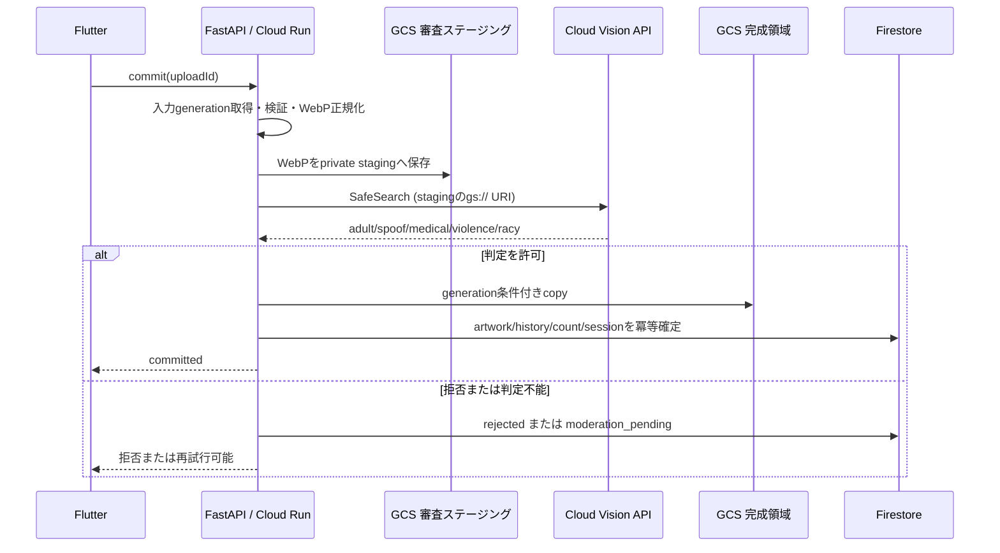

# Google Cloud Vision SafeSearch 実装設計書

> 現行デモでは一時Storage保存を廃止し、再検証後の画像バイト列を直接Visionへ渡す。以下のGCS URI方式は従来の設計案。現行手順は [Visionデモ](vision-web-demo.md) を参照。

- 対象: M1の作品投稿時に行う不適切画像判定
- 状態: 実装前の設計案。しきい値・再試行上限等は運用確認後に確定
- 関連: [作品画像処理・通信設計書](../image-processing-design.md)、[総合仕様書](../specification.md)

## 1. 目的と範囲

投稿画像をFastAPIで検証・正規化した後、Cloud Vision APIのSafeSearch Detectionで審査し、許可された画像だけを作品として確定する。Vision呼び出しは投稿commitのサーバー側処理に限定する。FlutterからVision APIを直接呼ばず、APIキーやサービス資格情報をクライアントへ渡さない。

本設計はSafeSearch接続と判定結果の扱いを定める。GCSへの一時保存・完成保存、Firestoreトランザクションの詳細な通信契約は画像処理設計書に従う。GCS担当の実装完了後、実際のbucket・prefix・generation取得方法と接続する。

## 2. 推奨アーキテクチャ



Cloud Visionには正規化済み画像のGCS URIを渡す。これによりbase64化によるメモリ増加とJSONリクエストの10 MB制限を避けられる。対象bucketは非公開のままにし、Vision実行主体に審査prefixの読み取りだけを付与する。VisionがGCS URIから読み取れること、正規化後の形式・サイズがAPI対応範囲内であることを開発GCP環境で確認する。

## 3. 呼び出し契約

### API機能

- API: Cloud Vision `images:annotate`
- 機能: `SAFE_SEARCH_DETECTION`のみを要求する
- 入力: FastAPIが生成したWebPオブジェクトの`gs://bucket/object` URI
- 応答項目: `adult`, `spoof`, `medical`, `violence`, `racy` の各Likelihood
- 画像ごとに1回呼び出し、同一upload sessionのcommit再送では既存の確定済み判定を再利用する

Googleライブラリで呼び出しをラップし、HTTP/SDK詳細を投稿処理から分離する。例として`SafeSearchClient.evaluate(gcs_uri) -> SafeSearchResult`を定義する。実装は同期SDKを使う場合もFastAPIのイベントループを塞がないようthreadpoolへ委譲する。

### 内部データモデル案

```text
SafeSearchResult
  status: complete | unavailable
  categories:
    adult: UNKNOWN | VERY_UNLIKELY | UNLIKELY | POSSIBLE | LIKELY | VERY_LIKELY
    spoof: 同上
    medical: 同上
    violence: 同上
    racy: 同上
  modelVersion: optional string
  checkedAt: timestamp
```

Likelihoodは序数として扱う。生レスポンス全文や画像bytesは保存・ログ出力しない。sessionにはカテゴリ別結果、ポリシーversion、判定時刻、最終状態を必要最小限記録し、再送時の一貫性と問い合わせ対応に使う。

## 4. 判定ポリシー

確定ポリシー（`possible-allowed-v1`）:

| SafeSearch値 | 処理 | M1での扱い |
|---|---|---|
| `VERY_UNLIKELY`, `UNLIKELY` | 承認 | 他カテゴリも許容なら作品確定へ進む |
| `POSSIBLE` | 承認 | 他カテゴリも許容なら作品確定へ進む |
| `LIKELY`, `VERY_LIKELY` | 拒否 | 完成領域に保存せず、利用者へ投稿不可を返す |
| 欠損、`UNKNOWN`、未知の列挙値 | 判定不能 | fail-closedで確定せず、retry可能状態または運用確認へ |

5カテゴリすべてに同じ閾値を適用する。カテゴリ別閾値が必要になった場合はpolicy versionを上げ、既存sessionの再試行時にもどのルールを使ったか追跡できるようにする。SafeSearchは確率的な補助判定であり、判定結果を「違法性の確定」として表示しない。拒否メッセージはカテゴリや内部スコアを露出しない汎用文言とする。

全カテゴリがPOSSIBLE以下ならapproved、1カテゴリでもLIKELY以上ならrejectedとする。拒否がなく、欠損・UNKNOWN・未知の値がある場合はretry_requiredとする。API障害は503のままとし、承認しない。現行デモはdecisionとpolicyVersionを返すが、投稿の保存・確定にはまだ接続していない。

## 5. 状態遷移・冪等性

```text
uploaded -> processing -> moderation_pending -> committed
                                  |
                                  +-> rejected
                                  +-> review_required (手動審査導入時)
                                  +-> failed_retryable (外部API障害)
```

- Vision成功かつ許可判定の後に限り完成領域へcopyし、artwork・履歴・累計をFirestore transactionで確定する。
- commitの重複要求はuploadIdで直列化する。`committed`なら保存済み結果を返し、二重作品・二重カウントを起こさない。
- Vision障害は`failed_retryable`/`moderation_pending`として保持し、同じ入力generationとstaging generationで再試行する。
- 処理中leaseまたはFirestore transactionを用いて、並行commitが二重Vision課金・二重確定を起こすのを抑止する。
- 拒否・期限切れ・再試行期限超過の一時画像はcleanup対象とする。cleanup失敗は後続ジョブで再回収する。
- Vision許可後に完成copyまたはFirestore確定が失敗した場合、同一sessionの再送でgenerationを確認して処理を再開する。

## 6. エラー処理と再試行

| 状況 | commit結果 | 方針 |
|---|---|---|
| Vision応答が正常・許可 | 成功 | 保存とDB確定へ進む |
| Vision応答が正常・拒否 | 4xx相当の業務結果 | `rejected`を記録。一時画像cleanup |
| deadline超過・一時的な5xx・429 | retry可能エラー（503） | `Retry-After`を返す。指数バックオフと上限付き再試行 |
| 認証・権限エラー | 運用障害（503） | fail-closed。短周期での無限再試行はしない。IAM/ADCを調査 |
| 不正URI・対応外形式・応答項目欠落 | retry不能または運用確認 | 完成確定しない。原因を分類して安全に終了 |
| 呼び出し元の切断・結果不明 | 状態照会後に再送 | 同じuploadIdで結果を確認し、二重確定防止 |

リトライ対象は一時的なネットワーク、429、5xx、deadline超過に限る。ジッター付き指数バックオフ、1リクエスト内の試行回数・全体処理期限を設ける。具体的な値はCloud Run timeoutとVision quotaを踏まえて設定値として決める。失敗を許可扱いにするfail-openは禁止。

FastAPI共通エラーenvelopeを使い、外部例外文・URI・bucket名をクライアントへ返さない。ログはrequestId、uploadId、処理段階、Google API status code、所要時間を記録し、画像bytes・認証token・署名URL・完全なGCS URIは記録しない。

## 7. 認証・IAM・ネットワーク

- Cloud RunはサービスアカウントのApplication Default Credentials (ADC)でGoogle APIへ接続する。鍵ファイルを環境変数・リポジトリ・コンテナへ格納しない。
- 実行サービスアカウントにはVision API呼び出し権限と必要なGCS操作権限のみを付与する。GCS担当とbucket範囲・役割を調整し、広範なEditor権限は使わない。
- Vision APIをGCP projectで有効化し、quota・課金・予算アラートを設定する。
- FlutterにはVision資格情報を与えず、Cloud Vision endpointへ直接接続させない。
- 開発・本番でproject/service account/bucketを分離し、本番画像を開発環境へコピーしない。

## 8. 設定・依存関係案

`back/app/config.py`へ環境差のある値を追加する。

| 設定案 | 用途 |
|---|---|
| `VISION_SAFESEARCH_ENABLED` | 開発のfake切替を含む明示的な有効化。環境既定値は本番fail-closed |
| `VISION_TIMEOUT_SECONDS` | 1回のAPI timeout |
| `VISION_MAX_ATTEMPTS` | 上限付き再試行回数 |
| `VISION_POLICY_VERSION` | 判定閾値セットの識別 |
| `VISION_*_MAX_LIKELIHOOD` | カテゴリ別の許容上限（初期は共通値も可） |

GCS URIはsession内で取得した正規化済みオブジェクトからサーバーが組み立てる。クライアント送信URIをそのままVisionへ渡さない。SDK依存はVision clientライブラリを追加し、ローカル・CIではfakeを注入できるようにする。未設定・ADC不備・API無効化を検知した場合、投稿を確定せず起動時または初回接続時に運用ログで明示する。

## 9. データ・プライバシー・運用

- Visionへ送るのはサーバー正規化後の画像。EXIF等の不要メタデータはVision送信前に除去する。
- Firestoreにはカテゴリ別Likelihoodとpolicy version等の最小限を保存する。生の画像は既存のprivate GCSライフサイクルに従い、Vision結果に含めない。
- Vision応答や画像をアプリケーションログ、エラー応答、分析イベントへ複製しない。
- 監視対象: 呼び出し数、成功/拒否/判定不能数、429/5xx/timeout率、レイテンシ、retry回数、孤立staging数、費用/quota。
- requestIdでCloud Runログとsessionを関連付け、利用者識別子を一般ログに過剰記録しない。
- コスト試算は投稿件数×Visionの実際の課金単位で行い、開発試験上限と予算アラートを設定する。

## 10. 実装分担と着手順

1. GCS担当のbucket/prefix/generation/IAM契約を確認する。Vision側が必要とするのは、FastAPIから審査用オブジェクトを読み取り可能なURIで参照できること。
2. `SafeSearchClient` interfaceとLikelihood/policy評価関数を実装し、fake応答で許可・拒否・境界・欠損を扱う。
3. FastAPI設定、ADCベースのVisionクライアント、timeout・retry・ログ分類を追加する。
4. artwork commitのWebP staging保存後、Vision判定ゲートを接続する。Vision許可より前に作品・履歴・累計を確定しない。
5. sessionに結果・policy version・再試行状態を保存し、重複commitと同時要求を冪等に処理する。
6. 開発GCPで少数のテスト画像を使い、実IAM、GCS URI入力、応答enum、API有効化、quota、Cloud Run時間上限を確認する。
7. 閾値、境界結果の利用者表示、予算アラート、再試行上限を決定して本番設定へ反映する。

## 11. 受け入れ条件

- Flutterや一般利用者からVision APIを直接呼べず、秘密情報を配布しない。
- サーバーが生成したprivate staging URIのみをVisionへ渡す。
- 5カテゴリのLikelihoodを正しく評価し、未知値・欠損・API障害を許可に変換しない。
- Vision成功かつポリシー許可のときだけ完成画像・作品・履歴・累計を確定する。
- 拒否、境界、API障害の結果を区別して保存し、画像cleanupまたは再試行が可能。
- commit再送・並行要求で二重課金と二重作品確定を抑止する。
- ログとクライアントエラーに画像・token・署名URL・内部GCS URIを含めない。
- 開発GCPでSafeSearchのGCS入力と最小権限IAMを確認し、課金・quota監視を有効にする。

## 12. 未確定事項

- 各SafeSearchカテゴリの許容上限は`POSSIBLE`以下に確定
- `POSSIBLE`は承認。手動審査フローは現行デモの対象外
- Vision・GCSにおける正規化WebPの対応確認と、非対応時の代替形式
- SDK timeout、最大attempt、session再試行期限
- Firestoreへ保存するmoderation項目と保持期間
- GCS担当が設定する審査prefix、サービスアカウント権限、削除責務
- Vision API quota、試験予算、月次上限・通知先

## 参考

- [SafeSearch Detection](https://cloud.google.com/vision/docs/detecting-safe-search)
- [Cloud Vision API request formats and image limits](https://cloud.google.com/vision/docs/request)
- [Cloud Vision supported files](https://cloud.google.com/vision/docs/supported-files)
- [Cloud Vision authentication](https://cloud.google.com/vision/docs/authentication)
