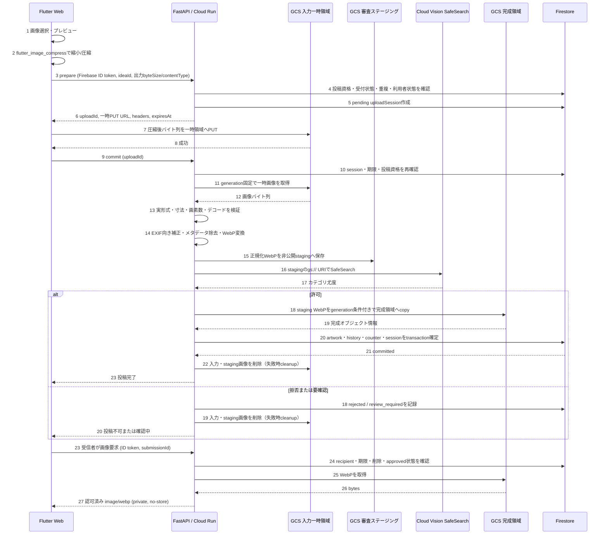
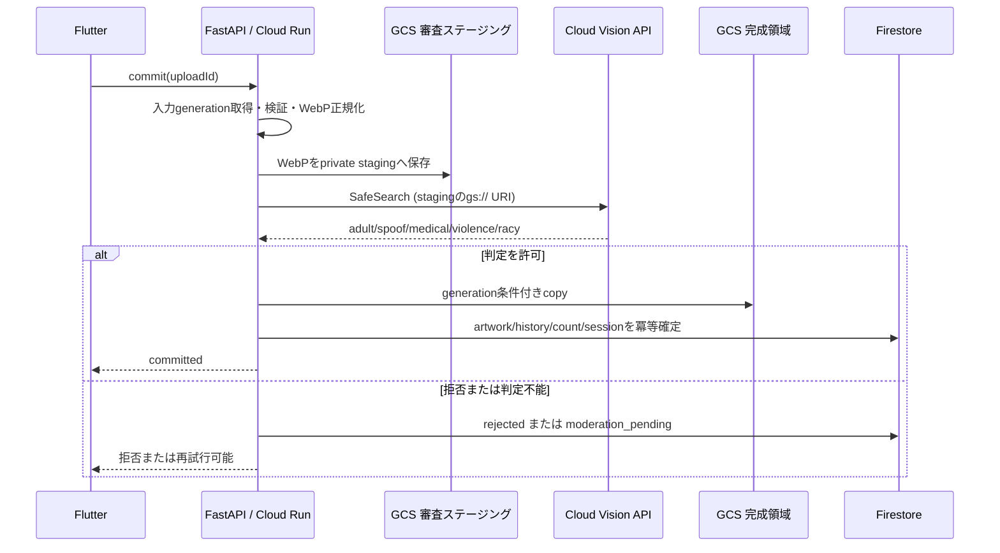

# 画像処理とSafeSearch

旧画像通信設計・SafeSearch設計を現行実装に合わせて統合しています。クライアントが署名URLで一時Storageへアップロードしてcommitする旧案は、現行の通常送信経路ではありません。

## 通常投稿の処理

1. Flutterで入力形式・容量を早期検査し、対応環境では事前変換・縮小してプレビューします。
2. Firebase IDトークンとmultipartで画像を `POST /api/v1/artworks` へ直接送ります。
3. APIが資格・期限・重複送信を確認し、試行を予約します。
4. APIで実画像の形式・フレーム数・画素数を検証し、EXIF向き補正・メタデータ除去・長辺2560以下への縮小を行います。
5. 正規化したJPEG/PNGのバイト列をVisionへ直接渡します。審査用GCS URIは使用しません。
6. 承認後のみWebP（quality 85）へ変換し、非公開Storageへ保存します。
7. Firestoreトランザクションで作品・描いた履歴・累計を確定します。失敗した試行や孤立画像は回収対象です。

クライアント側のMIME・拡張子・事前検査は信用境界にせず、APIが最終検証します。資格情報をFlutterへ渡しません。通信・冪等性・回収の詳細は [作品投稿API](artwork-submission.md) を参照してください。

## 制限の責務

| 層 | 現行の基準 |
|---|---|
| 投稿・VisionデモAPI | 入力画像20 MiB、multipart本文20 MiB + 64 KiB |
| 共通デコーダー | JPEG・PNG・HEIC/HEIF、静止画のみ、4000万画素以下、長辺2560以下へ縮小 |
| Visionへ直接渡す正規化画像 | 7,000,000 bytes以下 |
| 完成画像 | 審査承認後にWebPへ変換し非公開保存 |

共通画像処理関数の512 MiB上限は関数単体の安全上限で、通常APIの受付容量ではありません。Flutterの選択時上限・対応形式はAPIへ送る前の変換条件と分けて確認します。HEIC/HEIFのブラウザー表示可否にも差があります。

## SafeSearch判定

ポリシーは `possible-allowed-v2`（`back/app/vision_policy.py`）です。

| 対象 | 扱い |
|---|---|
| adult・spoof・violence | すべてPOSSIBLE以下ならapproved |
| 上記のいずれかがLIKELY以上 | rejected |
| 明確な拒否がなく、上記に不明・欠損がある | retry_required |
| medical・racy | 表示用に取得するが承認判断には使わない |

自動判定は確率的です。拒否は投稿を確定せず、判定不能・サービス障害も承認扱いにしません。APIは失敗表示・再試行へつなげます。

## Visionデモ

設定画面のVision APIデモは判定確認用で、作品保存・Firestore投稿確定は行いません。通常投稿と混同しないでください。

起動は [環境構築](../environment.md)・[起動方法](../startup.md) に従います。Vision APIの有効化・課金・呼出権限が必要です。デモ単体には作品Storageバケットは不要です。ログイン後にマイページ → 設定 → Vision APIデモを開きます。

## 検証・運用

形式偽装、アニメーション、巨大画素数、メタデータ除去、透過、容量、境界判定、欠損レスポンス、外部障害、送信再試行を確認します。代表画像でCloud Runのメモリ・タイムアウト・費用を測定し、上限変更はAPI・UI・文書を同時に更新します。

画像内容やトークンは共通ログへ出さず、失敗追跡にはrequestId・エラー種別を使います。画像保存失敗・DB確定失敗の回復と削除は [定期削除](cleanup.md) を参照してください。

<details>
<summary>統合前の設計記録・未決事項を開く</summary>

## 統合前の設計記録

以下は元文書を情報欠落なく保存した記録です。「実装前」「案」「未決」は当時の記載です。現行の動作は上記の仕様を参照し、将来要件は実装済みと扱わないでください。

## 統合元：image-processing-design.md

# 作品画像処理・通信設計書

> 現行デモの変更: Flutterで事前変換し、FastAPIで再検証後、画像バイト列をVisionへ直接送信する。Vision用の一時Storage保存は廃止した。以下の一時保存を用いた記述・図は従来の設計案であり、通常投稿の正式保存はまだ未接続。現行手順は [Visionデモ](image-processing.md) を参照。

- 対象: M1のイラスト投稿
- 方針: Flutterでアップロード前圧縮し、FastAPIで最終検証・WebP変換・不適切画像判定を行う
- 関連資料: [総合仕様書](../specification.md)、[DB・API仕様書](../database/DB_v0.md)
- Vision実装詳細: [Google Cloud Vision SafeSearch 実装設計書](image-processing.md)

## 1. 要約

Flutterは画像を選択・プレビューし、`flutter_image_compress`で可能な範囲で縮小・圧縮してからCloud Storageの非公開一時領域へ送る。FastAPIは一時画像を読み、実形式・寸法・デコード可否を確認し、メタデータを除去してWebPへ変換する。Cloud Vision SafeSearchで変換後画像を判定し、方針上許可されたものだけを非公開の完成領域へ保存し、Firestoreの投稿情報を確定する。

このため、先に作成したFastAPI画像処理コードは丸ごと不要にはならない。**画像形式・画素数検査、EXIF向き補正、メタデータ除去、サイズ調整の処理は流用可能**。ただし最終出力形式はJPEG/PNGではなくWebPへ変更し、Flutter側圧縮済み画像をもう一度高品質で再圧縮して劣化させない設定に見直す。現在は独立した変換関数であり、まだStorage・Vision・commit APIには接続されていない。

## 2. 層ごとの責務

| 層 | 責務 | 信用するもの |
|---|---|---|
| Flutter Web | 選択、プレビュー、形式の早期確認、`flutter_image_compress`による可能な範囲の事前圧縮、進捗・再試行表示 | ファイル選択と圧縮結果はUX向け。認可・最終形式判定には使わない |
| Cloud Storage一時領域 | prepareで発行した1オブジェクト分の短期アップロード先を受け、一時画像を非公開で保持 | クライアント指定MIMEやメタデータは信用しない |
| FastAPI / Cloud Run | 投稿資格、オブジェクトgeneration、実バイト列、容量・画素数を検証。メタデータ除去・WebP変換、SafeSearch判定、完成保存とDB確定、受信者認可付き配信、cleanup | 唯一の確定判断主体 |
| Cloud Vision API | SafeSearchのカテゴリ別尤度を返す | 自動判定は確率的。境界例は要確認扱いにできるよう状態設計する |
| Cloud Storage完成領域 | 判定を通過したWebPを非公開で保存 | Flutterや一般利用者から直接読めない |
| Firestore | uploadSession、作品状態、所有者、Storageパス、形式、期限を管理 | トランザクションで投稿・履歴・累計の整合を取る |

## 3. 通信シーケンス



### 通信量の意味

- Flutter圧縮で減るのは、ブラウザーからStorageへのアップロード量、およびその後のCloud Run→Visionへの入力データ量。
- FastAPIによるWebP変換は、最終保存容量と受信者への配信量を減らす役割。
- 画像データはFlutter→一時Storageへ1回送る。FastAPIが一時画像を読み込み、完成WebPを別オブジェクトとして保存する。これは同じファイルの二重アップロードではなく、仮置きと承認済み成果物の分離。
- Vision APIへbase64で画像を送るJSONリクエストは10 MB上限があり、Visionの画像上限も20 MB。大きい画像を扱えるよう、FastAPIが検証・WebP正規化した画像を非公開の審査ステージングへ置き、Vision APIにGCS URIを渡す。Vision呼出元に対象オブジェクトの読取権限を与え、対応形式・サイズ内であることも確認する。承認後はサーバー側copyで完成領域へ移し、審査用オブジェクトを削除する。[Vision SafeSearchのGCS入力](https://cloud.google.com/vision/docs/detecting-safe-search)、[Visionの形式・サイズ上限](https://cloud.google.com/vision/docs/supported-files)

## 4. Flutter圧縮の設計

### 使い方とプラットフォーム差

`flutter_image_compress`は画像バイト列を受け取り、指定した出力寸法・品質・形式で画像バイト列を返す。Webでは`compressWithList`を使う。ファイルパスを使う`compressWithFile` / `compressAndGetFile`はWebで使えない。Web版はCanvas `toBlob`に依存するため、品質とエンコード対応はブラウザーによって差がある。JPEG/PNG出力はWebを含む対応表にあるが、HEIC出力はWeb非対応。PNGのquality指定はiOS等で無視されることがある。[flutter_image_compress公式説明](https://pub.dev/packages/flutter_image_compress)

### 推奨処理

1. 元画像のbyteSizeが小さく、寸法も既に上限内なら、再エンコードを省いてよい。PNGは再エンコードしても小さくならず、少し大きくなる場合がある。
2. 元画像寸法を読み、長辺が暫定2,560pxを超える場合だけアスペクト比を保って縮小する。
3. 不透過のJPEGはJPEG出力で高めの品質から圧縮する。品質は初期案90〜94。通信削減率と画質を実画像で比較して調整する。
4. 透過PNGはPNG出力で透過を保ち、寸法縮小だけを行う。PNGのquality値で圧縮率が上がるとは期待しない。
5. `keepExif: false`を指定し、orientation補正が二重に掛からないよう`autoCorrectionAngle`の既定動作と元画像の向きを確認する。
6. 出力が元より大きいときは、圧縮出力を採用せず元画像を使う。ただし元画像もprepare/commitでサーバー検証し、高い上限を超える場合は拒否する。
7. 返り値が空または例外の場合は、圧縮失敗を扱う。受け付ける形式の元画像をそのままアップロードするフォールバックを許すか、明示的な再試行を求めるかを決める。HEICのWeb入力などデコード不能ケースは無条件のraw fallbackにせず、許容形式・サーバー処理能力を確認する。

`minWidth`/`minHeight`という引数名は上限寸法として働き、縦横比を保ち、拡大しない。固定byteSizeを狙うには品質や寸法を反復調整する必要があり、クライアント側で厳密な容量保証はできない。サーバーが実サイズを確認する。[API使用説明](https://pub.dev/documentation/flutter_image_compress/latest/)

### 入力形式

- JPEG・PNGはFlutter Webの主対象。
- WebPは入力非対応。
- HEIC/HEIFを投稿形式として維持する場合、Webでのデコード・圧縮を保証できない。ネイティブiOS/Androidでの対応もOS・エンコーダーに依存し得るため、Flutter圧縮できない時のサーバー変換fallbackを用意するか、M1でHEICを外してJPEG/PNGに限定するかを確定する。
- Web版利用者がHEICを選んだ時、処理に失敗してもアプリが黙って壊れないよう、対応外案内またはサーバー処理へ送る選択を示す。

## 5. FastAPIの既存画像処理コードをどう使うか

| 現在の処理 | 今後 | 理由 |
|---|---|---|
| 実画像デコーダーによる形式判定 | 維持 | Flutterの拡張子・MIME・圧縮結果を信用しない |
| 空/破損画像・アニメーション拒否 | 維持 | サーバー境界で不正データを排除 |
| 最大画素数の検査 | 維持 | 圧縮後でも画素爆弾や処理負荷を防ぐ |
| EXIF orientation適用 | 維持または出力確認後に簡素化 | 圧縮側の自動回転が確実とは限らない。サーバーが最終表示方向を保証 |
| メタデータ除去 | 維持 | プラグインは既定で除去を意図するが、プラットフォーム別結果もあり、サーバーで最終確認する |
| 2,560pxへの縮小 | 維持を安全fallbackとして推奨 | クライアントが縮小しない・迂回する場合にも完成品の寸法を揃える |
| PNG/JPEGへの出力 | 変更 | 審査・完成画像はWebPへ出力。透過はWebP alphaで保持 |
| 512 MiB固定上限 | 確定値ではなく設定化 | 安全弁として大きい値を仮置きしただけ。Cloud Run・GCS・Vision上限を測り調整 |
| Storage/Firestore接続 | 新規実装 | 現モジュールは独立関数で、Storage/API連携は未実装 |

FastAPIは通信経路に残り、作品を確定する信頼境界として必要。クライアント圧縮によりサーバーでの圧縮量は減るが、形式検証・画素制限・審査・権限確認・DB整合性は代替されない。

## 6. SafeSearchの判断と保存状態

SafeSearchはadult、spoof、medical、violence、racyの尤度を返す。APIが成功したことだけで承認せず、各カテゴリの判定しきい値と「要確認」状態を定義する。絵柄や文脈による誤判定を考慮し、M1で人手確認を用意しない場合は、結果をどう利用者に示すかを明記する。

| 判定結果 | 状態案 | 完成領域への保存 |
|---|---|---|
| 全カテゴリが許容範囲 | approved/committed | 可 |
| しきい値超過 | rejected | 不可。一時画像を削除 |
| 境界値・判定が曖昧 | review_required | 人手確認機能がなければ、M1では送信保留または拒否のどちらかを決める |
| APIタイムアウト・エラー・応答欠落 | moderation_pending / retryable | 不可。fail-openしない |

Vision障害時、Flutterは同じ`uploadId`でcommitを再試行できる。画像を再アップロード・再課金せず、保存済みgenerationに対する判定を再試行する。Vision利用料金・月次無料枠・課金アラートは環境担当と確認する。

## 7. 状態とAPIの契約案

### Upload session

`pending_upload → uploaded → processing → moderation_pending → committed`

終端・例外状態: `rejected`, `expired`, `failed_retryable`。セッションにはartistId、ideaId、submissionId、tempPath、inputGeneration、inputContentType、inputByteSize、status、expiresAt、moderation結果、完成path、変換仕様versionを保存する。Visionの生レスポンス全文や画像データは不要以上に保存しない。

### prepare

`POST /api/v1/artworks/prepare`は認証済みFlutterからideaId、圧縮後のcontentType・byteSizeを受ける。FastAPIは投稿資格・重複・受信者状態を確認し、pendingセッションと一時画像1個に限定した短期PUT権限を返す。公開read/list/delete権限は付けない。

### commit

`POST /api/v1/artworks/commit`はuploadIdを受ける。generationを固定し、検証→WebP化→審査用staging保存→SafeSearch (gs:// URI)→承認済みWebPを完成領域へcopy→Firestore transactionの順に行う。committed再送は既存結果を返す。Vision一時障害は再試行可能状態を返し、投稿を完成領域へ公開しない。

### image / download

FastAPIがFirebase ID tokenからUIDを得て、recipientId、deletedAt、expiresAt、approved状態を確認してから完成WebPを返す。公開URLや長期署名URLを返さず、`Cache-Control: private, no-store`を設定する。downloadも同じ権限確認を使う。

## 8. 失敗と再試行

| 失敗 | Flutter側 | サーバー側 |
|---|---|---|
| Flutter圧縮エラー | エラーを表示。安全に扱える許容形式のみ元画像で続行可能 | 実データを必ず検証 |
| PUT失敗/通信切断 | 同一画面で同じsessionに再送。完了有無を確認して二重作成を防ぐ | expiry後の一時物をcleanup |
| format/画素数拒否 | 対応形式・解像度の変更を案内。自動再試行しない | 415/413等で拒否し完成保存しない |
| WebP変換失敗 | 送信失敗を表示し再試行可能 | 一時物を保持して同一generationで処理再試行、期限後cleanup |
| Vision判定エラー | 「確認処理中・再試行」 | pendingのまま保持。承認扱いにしない |
| 判定拒否 | 結果を案内し、投稿を確定しない | rejected状態を記録し一時画像削除 |
| 完成保存後のDB失敗 | 同じuploadIdでcommit再送 | 完成物のgeneration・uploadId・仕様versionを照合して再利用し、二重加算を防止 |
| 応答が消えた | 同じuploadIdでcommit再送 | committedなら結果のみ返す |
| uploadId期限切れ | 送信履歴を確認して必要ならprepareからやり直す | expired化し、発行済み権限終了後に一時画像を回収 |

## 9. 開発・検証手順

1. Flutter Webで`compressWithList`によるJPEG/PNGの縮小・圧縮を試す。ChromeとSafari、代表的なiPadで品質、出力byteSize、透過、向き、処理時間、失敗を測る。
2. Android/iOSネイティブは別に確認する。Web結果と同一バイト列になる要件は置かず、画質・寸法・透過・メタデータの受け入れ条件を共通化する。
3. HEIC/HEIFはWeb・実機ごとに入力デコード可否を確認し、fallbackかM1対象外かを決定する。
4. FastAPIの画像処理関数をWebP出力へ変更し、入力形式・巨大画素・破損・orientation・metadata・透明度・出力寸法を単体検証する。
5. Vision APIはfakeで判定・エラー・timeout・しきい値を試し、開発用GCPプロジェクトでSafeSearchの実接続と費用を少数画像で確認する。
6. Storage/Firestoreはfake/emulatorで再試行・競合・cleanupを確認する。短期PUT・generation条件・VisionがGCS URIを読む権限は開発用実バケットで確認する。
7. 同じDockerイメージをローカル・Cloud Runへ使い、Cloud Runのmemory、timeout、concurrencyで最大寸法・代表HEIC/JPEG/PNGを処理する。
8. 利用者テストでは、圧縮前後の見た目、送信時間、失敗時説明、SafeSearch誤判定時の扱いを確認する。

## 10. 決定事項

- [ ] FastAPI完成画像はWebPとするか（この設計はWebPを推奨。PNG透過はアルファ保持WebPを利用）
- [ ] Flutter圧縮後の最大辺、JPEG品質の初期値と画質評価方法
- [ ] HEIC/HEIFをM1で維持するか。Flutter Webで未対応時のfallbackを設けるか
- [ ] FastAPIの画素数・入力byteSize・最終byteSizeの高い安全上限
- [ ] SafeSearchカテゴリごとの閾値、review_requiredのM1での扱い
- [ ] Vision失敗時の再試行回数・session保持期限
- [ ] 一時アップロードURL方式、TTL、bucket prefix、IAM/Roles、CORS
- [ ] Storage/Firestore/Firebase担当者との責任分界、API契約の確定
- [ ] 20ドルクレジット内での試験画像数・予算アラート

## 11. 受け入れ条件

- [ ] Flutter圧縮でJPEG/PNGのアップロード量が減るケースを測定し、増える画像では元画像を選べる。
- [ ] PNG透過、向き、色、見た目を維持し、可能な環境では位置情報等のメタデータを除去する。
- [ ] Web・iOS・Androidの出力が完全一致するとは仮定せず、FastAPIで実データを再検査する。
- [ ] WebP入力、破損画像、偽装MIME、アニメーション、巨大画素数を拒否する。完成画像はWebP。
- [ ] FastAPIが画像をWebPへ正規化し、許可されたContent-Typeと寸法のみ完成領域に保存する。
- [ ] SafeSearch判定が失敗・timeout・不明の場合、完成画像を公開・確定しない。
- [ ] Vision通過画像のみcompleted状態になり、DB失敗後の再試行でも作品・履歴・累計が一度だけ確定する。
- [ ] 受信者以外、期限後、削除後は画像を取得できない。
- [ ] 一時画像・拒否画像・孤立完成画像をcleanupで回収できる。

## 12. バックエンド全体への影響と変更案

この方式はバックエンド全体の置き換えではなく、**作品投稿の開始から承認・確定・閲覧・削除までを新しい縦断機能として追加**する変更である。既存のユーザー登録、お題CRUD、ピン、認証基盤は原則維持する。作品を確定する前にSafeSearchを通すため、既存の受信箱・描いた履歴・累計更新と投稿commitの接続点は変更対象となる。

| 領域・現状 | 変更案 | 影響 |
|---|---|---|
| `back/app/artworks.py`：受信箱・履歴・既読・いいねのみ実装。画像バイトや投稿APIなし | prepare/commitを追加し、Storage取得、実体検査、WebP化、SafeSearch、完成領域保存、Firestore確定をサービス層に分割。image/download/deleteも追加 | 主な実装対象。作品ドキュメントは承認後にだけ作成し、既存受信箱は未承認データを表示しない |
| `back/app/ideas.py`：`can_submit`相当の一覧判定・描いた履歴参照あり | 投稿資格を共有可能な関数へ切り出すか、既存ルールを参照してprepareとcommitの両方で再検証。最終確定トランザクションで重複を防ぐ | 受付期限・削除・ピン・自己投稿不可の判定を二重実装しない。idea投稿機能自体は変更不要 |
| `back/app/image_processing.py`：形式検証、EXIF補正、縮小、metadata除去、JPEG/PNG出力 | Flutter圧縮を前提にしつつ、サーバーを最終検証者として残す。出力をWebPへ変更し、透過alpha保持、入力・出力容量と画素数、アニメーション拒否を設定化 | 既存処理を再利用するが、そのまま投稿フローへはつながっていない。512 MiBは製品上限として扱わず、高い安全弁の設定値と実測値を分ける |
| `back/app/schemas.py`：prepare用入力モデルあり、APIは未実装 | Flutterが実際に送る圧縮後MIME・byteSizeと照合し、許容する入力形式・高位安全上限・応答契約を確定 | 現行HEIC/HEIF受入れはFlutter Web圧縮と不整合の可能性があり、Webでの扱いを別途確定。宣言値だけで実体を信用しない |
| `back/app/config.py`、`back/.env.example`：project/CORS等 | bucket名、prefix、session期限、画像安全上限、Vision閾値・timeout/retry等、環境差のある値を追加。秘密鍵を設定ファイルに置かずADC/IAMを使う | ローカル・CI・Cloud Runの設定項目とデプロイ手順に影響 |
| `back/requirements.txt`、`back/Dockerfile`：Firebase Adminと画像codecあり | GCS・Vision連携ライブラリを追加し、WebP encodeと必要入力codecをDocker内で確認。対応codec込みの同一イメージをローカル/Cloud Runで利用 | 依存関係・イメージサイズ・ビルド時間・メモリに影響 |
| `back/app/firebase.py` / `auth.py`：ADC初期化、Firebase ID token、active確認 | Firestore/Admin初期化とBearer認証は再利用。Storage/Visionクライアントを同じADC/IAM原則で初期化し、APIで所有者・受信者を明示認可 | 既存認証を置き換えない。Admin SDKはRulesを迂回するため認可実装が必須 |
| `back/app/errors.py`、`middleware.py`、`main.py` | 共通JSONエラー・requestId・no-storeを利用。Storage/Vision失敗をretryable 503等の業務エラーへ写像。cleanup routeは内部認証を必須化 | 共通基盤は小規模拡張。通常APIの保守応答、CORS、ログに画像データ・署名URL・tokenを出さないことを確認 |
| `artworks`/`drawnHistory` Firestore、indexes | uploadSessionsに状態、入力generation、変換version、moderation概要、期限を記録。作品・描いた履歴・累計は承認後に一度だけ確定。inboxは現行indexを維持できる形を優先 | pending画像をartworksに入れない。状態フィルターを加える場合はクエリ・index・DB仕様を同時更新 |
| Firebase/Storage運用設定 | private bucket、staging/final prefixのIAM、短期書込権限、generation precondition、Storage CORS、ライフサイクル/cleanupを設定 | GCP側設定も実装範囲。Firestore rulesだけではStorage保護にならない |

### 既存領域の扱い

- **原則そのまま**: Firebase ID tokenの検証、active user依存、ユーザー登録、アイデア作成・一覧・削除、pin CRUD、共通ページングとエラーenvelope。
- **接続・確認が必要**: 投稿資格判定、投稿済み重複判定、`drawnHistory`と`drawnCount`の確定、受信箱の承認済み作品だけ表示、既読・いいねが作品期限/削除後に既存仕様どおり動くこと。
- **追加**: Storage/Vision client、アップロードセッション状態機械、commitの再試行/idempotency、画像配信認可、cleanup内部認証と上限付きバッチ処理、Cloud Scheduler等の呼び出し設定。
- **他層**: Flutterの`flutter_image_compress`とPUT実装、Flutter側依存追加、Storage bucket/IAM/CORS、Vision API有効化・権限・予算監視も必要。Flutter圧縮だけではサーバー検証・Vision・認可・DB整合性を省略できない。

### 推奨する確定順序

1. 画像入力形式をFlutter Webを含めて固定し、特にHEIC/HEIFをM1で維持するかを決める。容量上限・最大画素数・出力形式・alpha・EXIF方針も同時に固定する。
2. API/Firestore契約と状態遷移を確定する。投稿資格の共有ルール、submissionIdの一意性、承認前に作品を作らないこと、Vision失敗時の再試行、拒否時の利用者表示を決める。
3. GCP環境を準備する。private bucket/prefix、IAM最小権限、Storage CORS、Vision API、ADC、費用アラートを開発環境から設定する。
4. `image_processing`のWebP出力と安全制限、設定・依存関係を更新する。
5. prepare/PUT/commitを実装する。prepareとcommit双方で投稿資格を確認し、generation固定・SafeSearch成功後に限って完成StorageとFirestoreへ冪等確定する。
6. 画像取得・download・削除・cleanupを追加し、受信者限定、期限時点の拒否、期限切れ一時物/孤立成果物回収を通す。
7. Flutter圧縮・通信再試行・進捗UIをAPI契約に接続し、全層をローカル/fake・開発GCP・Cloud Runで順に確認する。

### これまでの実装計画から変わる点

| これまでの計画 | 更新後 |
|---|---|
| Flutterで形式確認・必要なら圧縮する案の検討 | `flutter_image_compress`を使った事前圧縮を前提にする。Web・iOS・Androidで品質やcodecが違うため、寸法/画質などの受入基準を定めて実機確認する |
| FastAPI画像処理を中心に先に実装 | FastAPI画像処理は検証・最終正規化の部品として維持し、投稿資格・セッション・Storage/Vision・Firestore確定を合わせた投稿縦断フローを実装単位とする |
| PNG/JPEG出力・PNG透過保持を前提にした既存処理 | 入力の透過を保ったWebP alphaを最終形式にする。JPEGとPNGを同じエンコード品質で扱わない |
| 画像処理/APIだけを主な作業対象とする | `artworks.py`だけで完結しない。`ideas.py`の投稿条件、schema/config/errors/dependencies、Firestore indexes/model、Storage IAM/CORS/cleanup、Flutterクライアントを計画に含める |
| prepare/commitを後続のAPI作業として扱う | SafeSearch判定をM1投稿確定の必須ゲートとしてcommitに組み込む。Vision障害・不明結果はfail-closedかつ再試行可能状態とする |
| 投稿commit時に作品作成を中心に記述 | moderation通過後だけartwork/history/countを一度だけ確定。承認前の状態はuploadSession側に置き、受信箱・いいね・既読へ流さない |
| M1後半に期限削除・放置画像回収 | 一時領域のcleanup、拒否画像、staging画像、DB確定前に作った孤立完成画像の回収を投稿APIと同時に設計し、運用呼出元・内部認証まで実装対象に含める |

本変更はユーザーAPIやお題APIを置き換えない。ただしcommitが投稿資格・submissionId・履歴・累計を横断更新するため、これらの整合性確認は画像機能の受入条件に含める。

## 13. 実装状況と未確定事項の境界

このリポジトリの現状コードでは、認証・ユーザー・お題の各APIと受信箱/描いた履歴/既読/いいねは存在する。画像処理モジュールとprepare入力schemaは存在するが、画像処理はAPIやStorageへ接続されておらず、Storage/Vision client、prepare/commit、画像配信、cleanupは未実装である。M0の基盤APIを変更するより、M1作品投稿の縦断機能として拡張する。

また、総合仕様書のHEIC/HEIF入力維持と「Flutter Webでも圧縮」という方針には未解決の組合せがある。HEICをWebで安定して扱えない場合の選択肢（M1はJPEG/PNGに限定、またはWeb利用者向けサーバーfallback）を決めるまで、対応形式を確定扱いにしない。

## 参考資料

- [flutter_image_compress (pub.dev)](https://pub.dev/packages/flutter_image_compress)
- [flutter_image_compress API documentation](https://pub.dev/documentation/flutter_image_compress/latest/)
- [Cloud Vision SafeSearch](https://cloud.google.com/vision/docs/detecting-safe-search)
- [Cloud Vision image request formats](https://cloud.google.com/vision/docs/request)


---

## 統合元：google-cloud-vision-safesearch.md

# Google Cloud Vision SafeSearch 実装設計書

> 現行デモでは一時Storage保存を廃止し、再検証後の画像バイト列を直接Visionへ渡す。以下のGCS URI方式は従来の設計案。現行手順は [Visionデモ](image-processing.md) を参照。

- 対象: M1の作品投稿時に行う不適切画像判定
- 状態: 実装前の設計案。しきい値・再試行上限等は運用確認後に確定
- 関連: [作品画像処理・通信設計書](image-processing.md)、[総合仕様書](../specification.md)

## 1. 目的と範囲

投稿画像をFastAPIで検証・正規化した後、Cloud Vision APIのSafeSearch Detectionで審査し、許可された画像だけを作品として確定する。Vision呼び出しは投稿commitのサーバー側処理に限定する。FlutterからVision APIを直接呼ばず、APIキーやサービス資格情報をクライアントへ渡さない。

本設計はSafeSearch接続と判定結果の扱いを定める。GCSへの一時保存・完成保存、Firestoreトランザクションの詳細な通信契約は画像処理設計書に従う。GCS担当の実装完了後、実際のbucket・prefix・generation取得方法と接続する。

## 2. 推奨アーキテクチャ



Cloud Visionには正規化済み画像のGCS URIを渡す。これによりbase64化によるメモリ増加とJSONリクエストの10 MB制限を避けられる。対象bucketは非公開のままにし、Vision実行主体に審査prefixの読み取りだけを付与する。VisionがGCS URIから読み取れること、正規化後の形式・サイズがAPI対応範囲内であることを開発GCP環境で確認する。

## 3. 呼び出し契約

### API機能

- API: Cloud Vision `images:annotate`
- 機能: `SAFE_SEARCH_DETECTION`のみを要求する
- 入力: FastAPIが生成したWebPオブジェクトの`gs://bucket/object` URI
- 応答項目: `adult`, `spoof`, `medical`, `violence`, `racy` の各Likelihood
- 画像ごとに1回呼び出し、同一upload sessionのcommit再送では既存の確定済み判定を再利用する

Googleライブラリで呼び出しをラップし、HTTP/SDK詳細を投稿処理から分離する。例として`SafeSearchClient.evaluate(gcs_uri) -> SafeSearchResult`を定義する。実装は同期SDKを使う場合もFastAPIのイベントループを塞がないようthreadpoolへ委譲する。

### 内部データモデル案

```text
SafeSearchResult
  status: complete | unavailable
  categories:
    adult: UNKNOWN | VERY_UNLIKELY | UNLIKELY | POSSIBLE | LIKELY | VERY_LIKELY
    spoof: 同上
    medical: 同上
    violence: 同上
    racy: 同上
  modelVersion: optional string
  checkedAt: timestamp
```

Likelihoodは序数として扱う。生レスポンス全文や画像bytesは保存・ログ出力しない。sessionにはカテゴリ別結果、ポリシーversion、判定時刻、最終状態を必要最小限記録し、再送時の一貫性と問い合わせ対応に使う。

## 4. 判定ポリシー

確定ポリシー（`possible-allowed-v2`）:

| SafeSearch値 | 処理 | M1での扱い |
|---|---|---|
| `VERY_UNLIKELY`, `UNLIKELY` | 承認 | 他カテゴリも許容なら作品確定へ進む |
| `POSSIBLE` | 承認 | 他カテゴリも許容なら作品確定へ進む |
| `LIKELY`, `VERY_LIKELY` | 拒否 | 完成領域に保存せず、利用者へ投稿不可を返す |
| 欠損、`UNKNOWN`、未知の列挙値 | 判定不能 | fail-closedで確定せず、retry可能状態または運用確認へ |

adult・spoof・violenceに同じ閾値を適用する。medical（医療表現）とracy（刺激の強い表現）は結果の取得・表示のみとし、承認・拒否・判定不能の判断に使わない。カテゴリ別閾値が必要になった場合はpolicy versionを上げ、既存sessionの再試行時にもどのルールを使ったか追跡できるようにする。SafeSearchは確率的な補助判定であり、判定結果を「違法性の確定」として表示しない。拒否メッセージはカテゴリや内部スコアを露出しない汎用文言とする。

判定対象の3カテゴリがPOSSIBLE以下ならapproved、1カテゴリでもLIKELY以上ならrejectedとする。拒否がなく、欠損・UNKNOWN・未知の値がある場合はretry_requiredとする。API障害は503のままとし、承認しない。現行デモはdecisionとpolicyVersionを返すが、通常投稿では同じ基準を保存・確定の前に適用する。

## 5. 状態遷移・冪等性

```text
uploaded -> processing -> moderation_pending -> committed
                                  |
                                  +-> rejected
                                  +-> review_required (手動審査導入時)
                                  +-> failed_retryable (外部API障害)
```

- Vision成功かつ許可判定の後に限り完成領域へcopyし、artwork・履歴・累計をFirestore transactionで確定する。
- commitの重複要求はuploadIdで直列化する。`committed`なら保存済み結果を返し、二重作品・二重カウントを起こさない。
- Vision障害は`failed_retryable`/`moderation_pending`として保持し、同じ入力generationとstaging generationで再試行する。
- 処理中leaseまたはFirestore transactionを用いて、並行commitが二重Vision課金・二重確定を起こすのを抑止する。
- 拒否・期限切れ・再試行期限超過の一時画像はcleanup対象とする。cleanup失敗は後続ジョブで再回収する。
- Vision許可後に完成copyまたはFirestore確定が失敗した場合、同一sessionの再送でgenerationを確認して処理を再開する。

## 6. エラー処理と再試行

| 状況 | commit結果 | 方針 |
|---|---|---|
| Vision応答が正常・許可 | 成功 | 保存とDB確定へ進む |
| Vision応答が正常・拒否 | 4xx相当の業務結果 | `rejected`を記録。一時画像cleanup |
| deadline超過・一時的な5xx・429 | retry可能エラー（503） | `Retry-After`を返す。指数バックオフと上限付き再試行 |
| 認証・権限エラー | 運用障害（503） | fail-closed。短周期での無限再試行はしない。IAM/ADCを調査 |
| 不正URI・対応外形式・応答項目欠落 | retry不能または運用確認 | 完成確定しない。原因を分類して安全に終了 |
| 呼び出し元の切断・結果不明 | 状態照会後に再送 | 同じuploadIdで結果を確認し、二重確定防止 |

リトライ対象は一時的なネットワーク、429、5xx、deadline超過に限る。ジッター付き指数バックオフ、1リクエスト内の試行回数・全体処理期限を設ける。具体的な値はCloud Run timeoutとVision quotaを踏まえて設定値として決める。失敗を許可扱いにするfail-openは禁止。

FastAPI共通エラーenvelopeを使い、外部例外文・URI・bucket名をクライアントへ返さない。ログはrequestId、uploadId、処理段階、Google API status code、所要時間を記録し、画像bytes・認証token・署名URL・完全なGCS URIは記録しない。

## 7. 認証・IAM・ネットワーク

- Cloud RunはサービスアカウントのApplication Default Credentials (ADC)でGoogle APIへ接続する。鍵ファイルを環境変数・リポジトリ・コンテナへ格納しない。
- 実行サービスアカウントにはVision API呼び出し権限と必要なGCS操作権限のみを付与する。GCS担当とbucket範囲・役割を調整し、広範なEditor権限は使わない。
- Vision APIをGCP projectで有効化し、quota・課金・予算アラートを設定する。
- FlutterにはVision資格情報を与えず、Cloud Vision endpointへ直接接続させない。
- 開発・本番でproject/service account/bucketを分離し、本番画像を開発環境へコピーしない。

## 8. 設定・依存関係案

`back/app/config.py`へ環境差のある値を追加する。

| 設定案 | 用途 |
|---|---|
| `VISION_SAFESEARCH_ENABLED` | 開発のfake切替を含む明示的な有効化。環境既定値は本番fail-closed |
| `VISION_TIMEOUT_SECONDS` | 1回のAPI timeout |
| `VISION_MAX_ATTEMPTS` | 上限付き再試行回数 |
| `VISION_POLICY_VERSION` | 判定閾値セットの識別 |
| `VISION_*_MAX_LIKELIHOOD` | カテゴリ別の許容上限（初期は共通値も可） |

GCS URIはsession内で取得した正規化済みオブジェクトからサーバーが組み立てる。クライアント送信URIをそのままVisionへ渡さない。SDK依存はVision clientライブラリを追加し、ローカル・CIではfakeを注入できるようにする。未設定・ADC不備・API無効化を検知した場合、投稿を確定せず起動時または初回接続時に運用ログで明示する。

## 9. データ・プライバシー・運用

- Visionへ送るのはサーバー正規化後の画像。EXIF等の不要メタデータはVision送信前に除去する。
- Firestoreにはカテゴリ別Likelihoodとpolicy version等の最小限を保存する。生の画像は既存のprivate GCSライフサイクルに従い、Vision結果に含めない。
- Vision応答や画像をアプリケーションログ、エラー応答、分析イベントへ複製しない。
- 監視対象: 呼び出し数、成功/拒否/判定不能数、429/5xx/timeout率、レイテンシ、retry回数、孤立staging数、費用/quota。
- requestIdでCloud Runログとsessionを関連付け、利用者識別子を一般ログに過剰記録しない。
- コスト試算は投稿件数×Visionの実際の課金単位で行い、開発試験上限と予算アラートを設定する。

## 10. 実装分担と着手順

1. GCS担当のbucket/prefix/generation/IAM契約を確認する。Vision側が必要とするのは、FastAPIから審査用オブジェクトを読み取り可能なURIで参照できること。
2. `SafeSearchClient` interfaceとLikelihood/policy評価関数を実装し、fake応答で許可・拒否・境界・欠損を扱う。
3. FastAPI設定、ADCベースのVisionクライアント、timeout・retry・ログ分類を追加する。
4. artwork commitのWebP staging保存後、Vision判定ゲートを接続する。Vision許可より前に作品・履歴・累計を確定しない。
5. sessionに結果・policy version・再試行状態を保存し、重複commitと同時要求を冪等に処理する。
6. 開発GCPで少数のテスト画像を使い、実IAM、GCS URI入力、応答enum、API有効化、quota、Cloud Run時間上限を確認する。
7. 閾値、境界結果の利用者表示、予算アラート、再試行上限を決定して本番設定へ反映する。

## 11. 受け入れ条件

- Flutterや一般利用者からVision APIを直接呼べず、秘密情報を配布しない。
- サーバーが生成したprivate staging URIのみをVisionへ渡す。
- 5カテゴリのLikelihoodを正しく評価し、未知値・欠損・API障害を許可に変換しない。
- Vision成功かつポリシー許可のときだけ完成画像・作品・履歴・累計を確定する。
- 拒否、境界、API障害の結果を区別して保存し、画像cleanupまたは再試行が可能。
- commit再送・並行要求で二重課金と二重作品確定を抑止する。
- ログとクライアントエラーに画像・token・署名URL・内部GCS URIを含めない。
- 開発GCPでSafeSearchのGCS入力と最小権限IAMを確認し、課金・quota監視を有効にする。

## 12. 未確定事項

- 各SafeSearchカテゴリの許容上限は`POSSIBLE`以下に確定
- `POSSIBLE`は承認。手動審査フローは現行デモの対象外
- Vision・GCSにおける正規化WebPの対応確認と、非対応時の代替形式
- SDK timeout、最大attempt、session再試行期限
- Firestoreへ保存するmoderation項目と保持期間
- GCS担当が設定する審査prefix、サービスアカウント権限、削除責務
- Vision API quota、試験予算、月次上限・通知先

## 参考

- [SafeSearch Detection](https://cloud.google.com/vision/docs/detecting-safe-search)
- [Cloud Vision API request formats and image limits](https://cloud.google.com/vision/docs/request)
- [Cloud Vision supported files](https://cloud.google.com/vision/docs/supported-files)
- [Cloud Vision authentication](https://cloud.google.com/vision/docs/authentication)


---

## 統合元：vision-web-demo.md

# Vision API Webデモ（ローカル）

## 処理の順序

1. Flutterで形式・容量を確認し、表示可能な静止画を長辺2560px以下のPNGへ変換する。
2. 「判定する」で認証トークンと画像をFastAPIへ送信する。
3. FastAPIで受信容量・実形式・画素数・デコード可否を再検証し、向き補正・メタデータ除去・JPEG/PNG変換を行う。
4. 検証済みの画像バイト列をCloud Vision SafeSearchへ直接渡し、結果を返す。

Vision判定用のCloud Storage一時保存・削除・公開URLは不要。作品の閲覧権限は変更しない。これは判定デモであり、作品の正式保存・Firestoreへの投稿確定はまだ接続していない。

## 起動

1. Google CloudプロジェクトでVision APIと課金を有効化する。
2. `back/.env.example`を`back/.local.env`へコピーし、`GOOGLE_CLOUD_PROJECT`を設定する。バケット設定・Storage権限は不要。
3. `gcloud auth application-default login` と `gcloud auth application-default set-quota-project YOUR_PROJECT_ID` でADCを設定する。
4. `back`で依存をインストールし、`uvicorn app.main:app --reload --port 8080` を起動する。
5. `flont`で `flutter pub get` と `flutter run -d chrome --web-port=3000` を実行する。
6. ログイン後、マイページ → 設定 → Vision API デモを開く。

## 容量・形式

入力はJPEG/PNG/HEIC/HEIF、画像本体は20 MiBまで。HEIC/HEIFは端末のデコーダーが対応する場合のみFlutterで変換可能。非対応環境ではJPEG/PNGへの選び直しを案内する。アニメーション・4000万画素超過は拒否する。

FastAPIの受信本文はmultipart付帯情報を含め20 MiB + 64 KiBまで。Content-Lengthが省略・偽装されても実受信量で制限する。変換後の直接送信画像は7,000,000バイトまでとし、Base64化してもVisionの10MB JSON制限に余裕を持たせる。

公式の制限: https://docs.cloud.google.com/vision/quotas

## 判定基準

判定対象のadult・spoof・violenceがすべてPOSSIBLE以下ならapproved、1カテゴリでもLIKELY以上ならrejected。不明・欠損は、拒否カテゴリがない場合retry_requiredとする。応答のdecisionとpolicyVersionで確認できる。判定デモなので作品の正式保存は行わない。

medicalとracyは表示用に取得するが、判定から除外する。両カテゴリの高い値・不明・欠損で投稿を拒否または保留にしない。ポリシーはpossible-allowed-v2。

</details>
