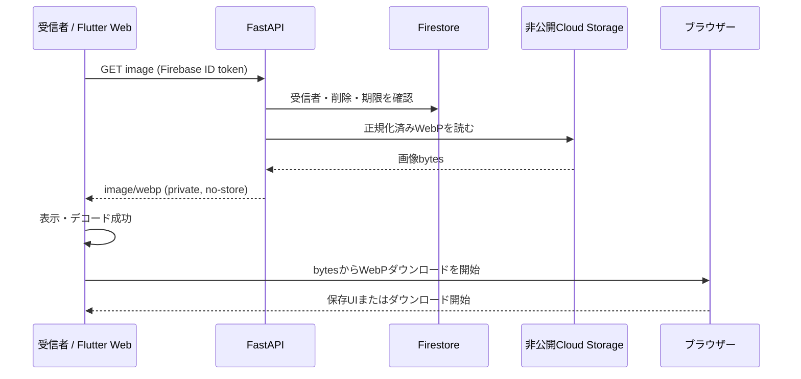

# 受信作品の表示・保存

## 現在のWeb実装

受信箱から作品詳細を開き、画像の表示完了後に「画像保存」または長押しメニューから保存できます。認証付き `GET /api/v1/artworks/{id}/image` で取得したbytesを使い回し、保存用の追加API通信はしません。

| 利用形態 | ファイル名 | MIME |
|---|---|---|
| 通常ログインの受信作品 | `artwork.webp` | `image/webp` |
| 認証なしプレビュー | `artwork.png` | `image/png` |

WebではBlob URLとdownload属性を使います。端末への永続保存完了をブラウザーから保証するものではなく、ダウンロード開始とファイルの存在は区別します。

## 認可・期限

- 画像取得は認証済み受信者に限定し、削除済み・期限切れの作品は取得できません。
- 公開URLや長期署名URLを使わず、Storageパスをクライアントへ公開しません。
- 画像取得失敗では既読にせず、期限到達後の表示・操作を禁止します。
- メモリ内LRUキャッシュは表示用で、端末への保存とは別です。
- ダウンロード済みの端末コピーは利用者の管理下にあり、サーバーの7日期限削除では回収できません。

## 確認手順

1. [起動方法](../startup.md) の認証なしプレビューを起動し、受信箱のサンプルを開きます。
2. 表示完了後に画像保存を押し、ダウンロードしたPNGが開けることを確認します。
3. 通常ログインでも有効な受信作品からWebP保存を確認します。プレビューでは実サーバーの認可は検証できません。
4. 取得失敗・期限切れ・二重押下、ファイル名・MIME・実画像形式の一致を確認します。

## 未対応・今後の判断

Android/iOSのネイティブ保存はstubで未対応です。Webでの保存をネイティブ対応済みとは扱いません。iOS Safari等のダウンロード差異や代替UIは実機確認が必要です。

仕様書に残る専用 `/download` APIは現行経路ではありません。追加する場合は `/image` と同じ認可・期限判定を共有し、取得bytesの再利用方式から変える理由を明記します。

サーバー側は [作品投稿API](../back/artwork-submission.md)、[定期削除](../back/cleanup.md) を参照してください。

統合前の保存機能設計・確認項目を開く

# 受信画像保存の仕様・設計記録

現在のWebは取得済みbytesを保存し、通常はartwork.webp、プレビューはartwork.pngです。ネイティブ保存は未対応です。以下は実装判断を含む元の設計記録です。チェック欄は当時の記録で、公開済みの証明ではありません。

# 受信作品画像の端末保存 設計書

- 対象: M1受信者による受信作品の端末保存
- 整理日: 2026年11月9日
- 関連資料: [総合仕様書](../specification.md)、[DB・API仕様書](../database/DB_v0.md)、[作品画像処理・通信設計書](../back/image-processing.md)、[作品投稿API](../back/artwork-submission.md)
- 状態: 既存実装と次の実装手順を整理した設計案

## 1. 目的と既定方針

受信者がお題への返信として受け取った作品画像を、自分の端末へ保存できるようにする。保存対象はサーバーで審査・正規化されたWebP画像とし、送信者・第三者からの取得を防ぐ。端末へ保存されたコピーは利用者の管理下に移り、サーバー側の7日保持・削除対象には含めない。

画像表示と保存の権限確認は同じ条件を使う: 認証済み受信者であり、作品が削除されておらず、サーバー時刻で期限内であること。画像の取得に公開URLや長期有効な署名URLは使わない。

## 2. 現状の進捗

| 層 | 現状 | 保存機能への意味 |
|---|---|---|
| 投稿・完成画像 | `POST /api/v1/artworks` が画像を受信し、検査・SafeSearch後にWebPとしてCloud Storageへ保存 | 保存対象の正規化済み原本はある |
| 画像の認証付き取得 | `GET /api/v1/artworks/{id}/image` が実装済み | 詳細画面の表示に使う。応答は画面描画用の扱い |
| Flutter画像キャッシュ | `ArtworkImageCache` はメモリ内LRUで期限・件数・容量を制御 | 保存操作時に詳細画面のbytesを使い回せる。永続保存ではない |
| 保存ボタン・画面処理 | 詳細画面に「画像保存」操作、期限・表示完了に基づく操作可否、成功/失敗表示がある | UIの入口と処理状態は存在する |
| ブラウザー保存 | Web実装がBlob URLと`download`属性でファイル保存を開始 | Webでのダウンロード処理の骨格はある |
| 詳細画面への接続 | 実受信箱・ローカルプレビューの両方で保存操作を有効化 | 実作品は期限・表示完了・処理中状態の画面条件に従う |
| 保存API・ファイル名・MIME | DB/API仕様には専用`GET .../download`案があるが、Flutterは既取得bytesを使って保存する | 実作品は`artwork.webp` / `image/webp`、認証なしプレビューの生成画像は`artwork.png` / `image/png`に揃える。追加のダウンロードAPI通信は発生しない |
| 非Web | stubは未対応エラーを返す | M1対象がFlutter Webなら対象外として明示。ネイティブ対応を要件にする場合は別実装が必要 |

上表の読み取りは2026年11月9日のコード確認に基づく。画像取得・画面キャッシュの存在は保存機能が完成していることを意味しない。

## 3. 推奨する実装方針

M1の現行対象がFlutter Webであるため、Webブラウザーへの保存を行う。表示時に認証付きAPIから受け取ったbytesを再利用し、詳細画面の保存導線からブラウザーのダウンロードを開始する。画像再取得やCloud Storageへのクライアント直アクセスは増やさない。実作品はサーバーから届いたWebP bytesを変換せず保存する。認証なしプレビューではローカル生成PNGを形式どおり保存する。

サーバーの`/image`は`private, no-store`で画面表示に使い、ダウンロードとしての保存契約が必要なら専用`/download`を追加する。総合仕様書とDB/API仕様書は添付ヘッダーを定義したダウンロードAPI案を記載しているため、実装前にどちらを正とするか揃える。M1最短実装案は「既取得bytesをWeb保存し、サーバーAPI追加なし」。専用APIを採用する場合は、`/image`と同じ認可関数・期限判定を共有し、`Content-Disposition: attachment`と`image/webp`を付ける。

ブラウザーによって保存ダイアログの表示やダウンロード開始通知は異なる。UIの「保存しました」は端末への永続化を保証できないため、「画像の保存を開始しました」程度の案内とする。

## 4. データフロー

## 5. 実装の着手順

### 1) 保存操作が通常の受信箱で有効になる条件を直す

受信箱の`ArtworkDetailScreen`生成時に渡す`allowFileActions`と`_isPreview`の意味を確認する。通常のログイン利用で、画像の表示成功・有効期限内・操作中でない条件を満たしたら保存できるようにする。プレビュー用ダミーデータは保存ボタンを無効のままにする。

### 2) 正規化画像の形式を保存処理まで通す

現行の完成画像はWebPである。ダウンロードファイル名を`artwork.webp`、BlobのMIMEを`image/webp`に揃える。将来複数形式を返す場合に備え、ファイル名とMIMEを保存関数の引数として渡す設計にする。

### 3) ブラウザー保存のリソース管理を仕上げる

Blob URLを作り、一時的なリンクをクリックしてからリンクをDOMから外す。URLは一定時間後にrevokeする。連続タップを防ぎ、成功開始・失敗を利用者へ表示する。保存後にメモリキャッシュを消したり、サーバーの作品を削除したりしない。

### 4) サーバーAPI契約を揃える

専用`GET /api/v1/artworks/{submissionId}/download`を実装するか、画面取得済みbytesを保存する現行案を採用するか決定する。専用APIの場合、画像表示と同じ受信者・削除済み・期限切れチェックを共通化し、Storageパスをクライアントへ返さない。レスポンスは`image/webp`、`Content-Disposition: attachment; filename="artwork.webp"`、`Cache-Control: private, no-store`とする。取得不可は共通404、一時障害は再試行可能なエラーとする。

### 5) 操作結果と期限のふるまいを揃える

画像のデコードに成功するまでは保存を無効にする。期限到達、削除、画面離脱時は操作を止める。保存開始後に期限が到達した場合でも、既にブラウザーへ渡したbytesを取り消せるとは扱わない。期限後に再取得・再保存はできない。

### 6) 受け入れ確認を行う

通常の受信作品を開いて保存でき、WebPとして開けること、名前とMIMEが一致すること、送信者や第三者が取得できないことを確認する。期限切れ・手動削除・画像取得失敗では保存できず、画像表示後の保存失敗では再操作できることも確認する。Chrome/Safariとスマートフォン幅のブラウザーでダウンロード動作を確認する。

## 6. 失敗・権限・プライバシー

| 状況 | 期待動作 |
|---|---|
| 画像取得・デコード失敗 | 保存操作を出さない。画像を再試行する |
| 保存開始エラー | 作品を既読状態や削除状態に変更せず、失敗を表示して再操作可能にする |
| 未ログイン・別ユーザー・期限切れ・削除済み | サーバーで画像を返さず、存在を区別しない取得不可応答 |
| Cloud Storage一時障害 | 保存失敗として扱い、認可を迂回したURLに切り替えない |
| 有効期限 | 画像APIと専用ダウンロードAPIで同一のサーバー時刻判定を行う |
| ローカルコピー | サービス側からの削除・失効を保証しない。利用者の端末管理に委ねる |

受信画像は個別受け渡しの非公開作品である。M1では受信者の端末保存を許可するが、外部SNS共有機能は追加しない。

## 7. 実装対象と責務

| ファイル・領域 | 変更内容 |
|---|---|
| `flont/lib/screens/inbox_screen.dart` | 通常受信箱で保存操作を有効にする条件を整理 |
| `flont/lib/screens/artwork_detail_screen.dart` | 保存可能条件、ファイル名/MIME受け渡し、進行・結果表示を維持・調整 |
| `flont/lib/services/artwork_file_actions.dart` | 形式情報を含む共通保存インターフェース |
| `flont/lib/services/artwork_file_actions_web.dart` | WebP Blob保存、リンクとObject URLの解放 |
| `flont/lib/services/artwork_file_actions_stub.dart` | Flutter Web以外では未対応を明示するか、対応プラットフォームの実装を追加 |
| `flont/test/` | 保存ボタンの有効条件、正しいファイル名/形式、失敗時の再操作を確認 |
| `back/app/artworks.py`（専用APIを選ぶ場合） | 認可済みダウンロード応答と添付ヘッダーを追加 |
| `docs/specification.md` / `docs/database/DB_v0.md` | 選択したAPI方式と受け入れ条件を正本へ反映 |

## 8. 決定が必要な項目

- [ ] M1の対象をFlutter Webに絞り、Android/iOSの端末保存を後続にする（推奨）
- [ ] 既取得画像bytesを保存に使うか、仕様書記載の専用`/download` APIを実装するか（Web最短経路は既取得bytes）
- [ ] ファイル名に作品IDや日付を含めるか、固定名`artwork.webp`にするか
- [ ] iOS Safariなどで保存動作に差がある場合、保存リンクを表示する代替UIを用意するか

## 9. 完了条件

- [ ] 通常の受信箱の有効な受信作品から、受信者が正規化済みWebPを端末へ保存できる。
- [ ] ファイル拡張子、Blob MIME、実画像形式が一致する。
- [ ] 表示・保存操作は認証、受信者、未削除、有効期限の条件に従う。
- [ ] 公開URLや長期署名URLを利用せず、Storageパスをクライアントへ公開しない。
- [ ] 一時キャッシュとブラウザー保存の成否を混同せず、失敗時に再操作できる。
- [ ] 保存済み端末コピーはサーバーの期限削除対象外であり、利用者の管理下にある。

